<a name="english"></a>

<div align="center">

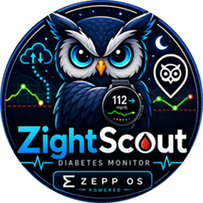

# 💉 ZightScout

### CGM Glucose Monitor for Amazfit & Zepp OS smartwatches

**Your glucose data always on your wrist — fast, smart, and accessible.**

[](https://github.com/marcioamaro/ZightScout)
[](https://docs.zepp.com/)
[](LICENSE)
[](#supported-smartwatches-en)
[](#supported-languages-en)
[](https://buymeacoffee.com/marcioamaro)
[](mailto:zightscout@gmail.com)

---

🇺🇸 **English** | [🇧🇷 Português](#português) | [🇪🇸 Español](#español) | [🇫🇷 Français](#français) | [🇩🇪 Deutsch](#deutsch) | [🇨🇳 中文](#中文) | [🇯🇵 日本語](#日本語)

---

</div>

## ❤️ Welcome to ZightScout!

Living with diabetes and having to track glucose levels all day long is challenging. **ZightScout** was built to make this simpler: it connects your Amazfit smartwatch directly to your **Nightscout** server, displaying real-time glucose readings, vibrating alerts when levels leave your target range, and monitoring continuously in the background — even with the watch screen turned off.

No need to pull your phone out of your pocket. Just glance at your wrist. 💚

---

## 📸 Watch Screenshots

### Main Screen

| mg/dL | mmol/L |
|:---:|:---:|
| 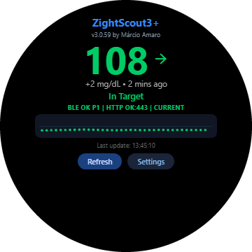 | 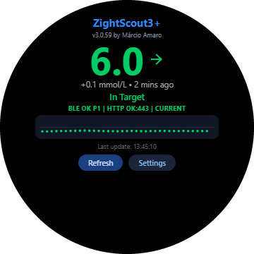 |
| Glucose in mg/dL with trend arrow | Glucose in mmol/L with delta |

### Settings

| Ranges & Targets | Alerts & Vibration | Server & Token |
|:---:|:---:|:---:|
| 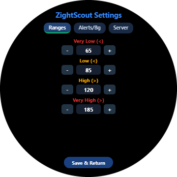 | 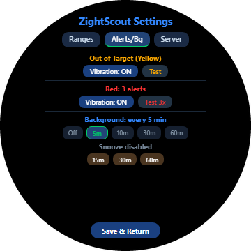 | 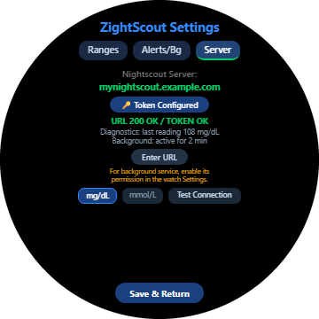 |
| Set your glucose thresholds | Configure alerts and vibrations | Connect to your Nightscout |

---

## ✨ What makes ZightScout special?

### 🩸 Real-time glucose reading
Your current glucose value directly on your watch, in **mg/dL** or **mmol/L**, complete with 9-direction trend arrows (⇈ ↑ ↗ → ↘ ↓ ⇊ ⇕ -) and delta since the last reading. You will always know where your numbers are headed.

### 🔔 Smart vibration alerts
Feel wrist alerts whenever your glucose leaves your customized target boundaries:
- **⚠️ Warning Alert** — glucose below or above configured target limits
- **🚨 Critical Alert** — severe hypoglycemia or acute hyperglycemia, with intense vibration and automatic retry steps
- **😴 Alert Snooze** — temporarily mute alerts for 15, 30, or 60 minutes when needed

### 🌙 Background monitoring
ZightScout continues checking your glucose even when the watch screen is off. Select polling intervals of **5, 10, 30, or 60 minutes** and rest easy — your watch will wake you if needed.

### 📊 Visual 12-hour history chart
A built-in glucose graph of the last **12 hours** of readings right on your watch screen, fixed to a 40–250 mg/dL scale for effortless visual assessment.

### 🔒 Security by design
Your Nightscout authentication token is **never stored on the watch**. It remains protected on your phone inside the Zepp App. Server URLs are verified in real-time, and HTTPS is strictly required.

### 🌍 34 native languages
ZightScout speaks your language! Full native translation into **34 languages**, including Arabic, Hebrew (with bidirectional RTL layout), Thai, Hindi, and more.

### 📱 8 Amazfit smartwatch families
Fully compatible with 8 Amazfit smartwatch families running Zepp OS 3.0+ and all their regional variants.

---

## 🚀 Quick Install (via QR Code)

The fastest way to install ZightScout on your smartwatch:

```bash
# 1. Install Zeus CLI (official Zepp OS developer tool)
npm install -g @zeppos/zeus-cli

# 2. Log in with your Zepp account
zeus login

# 3. Clone repository
git clone https://github.com/marcioamaro/ZightScout.git
cd ZightScout

# 4. Install dependencies
npm install

# 5. Generate installation QR Code
zeus preview
```

In the **Zepp** phone app:
1. Open Zepp app → **Profile → Settings → About**
2. Tap the Zepp icon **7 times** to unlock Developer Mode
3. Navigate to **Profile → Your Device → Developer Mode**
4. Tap **Scan** and scan the terminal QR code
5. ✅ Done! ZightScout will install onto your watch automatically

---

## 🔧 Manual Build & Installation (Step by Step)

### Prerequisites

| Tool | Minimum Version | Purpose |
|---|---|---|
| [Node.js](https://nodejs.org/) | 18+ | Run build scripts and tooling |
| [Zeus CLI](https://docs.zepp.com/docs/watchface/guides/zeus-cli/) | Latest | Compile and deploy to watch |
| Zepp Account | — | Authentication for Zeus CLI |
| Zepp App | Latest | Install on watch via QR or bridge |

### Step 1 — Clone the repository

```bash
git clone https://github.com/marcioamaro/ZightScout.git
cd ZightScout
```

### Step 2 — Install dependencies

```bash
npm install
```

### Step 3 — Log in to Zeus CLI

```bash
zeus login
```
> Use the same account as your phone's Zepp app.

### Step 4 — Compile the app

```bash
# Development build
zeus build

# Production build (optimized)
zeus build --production
```

The compiled package (`.zab`) is generated in `dist/`.

### Step 5 — Deploy to watch

**Option A: Via QR Code (easiest)**
```bash
zeus preview
```
Scan the QR code with the Zepp phone app.

**Option B: Via Bridge (recommended for developers)**
```bash
# Start bridge
zeus bridge

# In bridge prompt, run:
connect
install -t "Amazfit Active 2 (Round)"
```

> Replace `"Amazfit Active 2 (Round)"` with your target device name if different.

---

## ⚙️ Initial Watch Setup

After installation, ZightScout assists you with a setup wizard:

1. **Launch the app** on your watch — initial setup notice appears
2. Go to the **Server** tab and enter:
   - **Nightscout URL**: `https://your-site.nightscout.io` (must use HTTPS)
   - **Access Token**: your Nightscout token with read permissions
3. Tap **Test Connection** — displays `URL 200 OK | TOKEN OK` when verified
4. Set your **glucose target thresholds** in the **Ranges** tab
5. Configure your **vibration alerts** in the **Alerts** tab
6. Choose your **background polling interval** (5, 10, 30, or 60 min)
7. ✅ All set! ZightScout begins monitoring right away

---

## 📋 Comprehensive Feature List

### Main Screen
- ✅ Large easy-to-read glucose reading (mg/dL or mmol/L)
- ✅ 9-direction trend arrow (⇈ ↑ ↗ → ↘ ↓ ⇊ ⇕ -)
- ✅ Delta from previous reading (e.g., +3, -8)
- ✅ Time since last reading update (e.g., "2 min ago")
- ✅ Real-time Bluetooth and HTTP status indicators
- ✅ Manual instant refresh button
- ✅ Discrete app version indicator

### Background Monitoring
- ✅ Automated polling every 5, 10, 30, or 60 minutes
- ✅ Functions while screen is off and device is locked
- ✅ Native background permissions authorization via Zepp OS
- ✅ Automatic service resumption following watch reboots
- ✅ Diagnostics event logging for troubleshooting

### Alert Engine
- ✅ Warning alert (gentle vibration) for custom range boundaries
- ✅ Critical alert (intense vibration, up to 3 retries) for severe lows/highs
- ✅ System-native notification tones
- ✅ Event deduplication — avoids duplicate notifications for the same reading
- ✅ Snooze intervals for 15, 30, or 60 minutes
- ✅ Single-tap snooze dismissal from the main watch face
- ✅ Persistent alert queue to guarantee no missed urgent alerts

### Settings
- ✅ User-definable thresholds: veryLow, low, high, veryHigh
- ✅ Seamless mg/dL and mmol/L auto-conversion
- ✅ Real-time Nightscout URL and token health checks
- ✅ Token permission level badge (Read-only ✅ vs Admin ❗)
- ✅ Interactive animated toast notifications for all operations

---

<a name="supported-smartwatches-en"></a>
## 📱 Supported Smartwatches

ZightScout is compatible with **8 Amazfit smartwatch families** and their variants:

- **Amazfit Active** (and variants)
- **Amazfit Balance** (and variants)
- **Amazfit Cheetah** (and variants)
- **Amazfit Falcon** (and variants)
- **Amazfit GTR** (and variants)
- **Amazfit GTS** (and variants)
- **Amazfit T-Rex** (and variants)
- **Amazfit Bip** (and variants)

> Supports devices running Zepp OS 3.0+ with high-resolution displays. Low-resolution displays (< 390×400 px) are excluded to preserve visual precision and data readability.

---

<a name="supported-languages-en"></a>
## 🌍 Supported Languages

ZightScout features native translations across **34 languages**:

🇧🇷 Portuguese (BR) · 🇵🇹 Portuguese (PT) · 🇺🇸 English · 🇪🇸 Spanish · 🇫🇷 French · 🇩🇪 German · 🇮🇹 Italian · 🇯🇵 Japanese · 🇨🇳 Chinese (Simplified) · 🇹🇼 Chinese (Traditional) · 🇰🇷 Korean · 🇷🇺 Russian · 🇸🇦 Arabic · 🇮🇳 Hindi · 🇹🇭 Thai · 🇻🇳 Vietnamese · 🇵🇱 Polish · 🇳🇱 Dutch · 🇸🇪 Swedish · 🇩🇰 Danish · 🇫🇮 Finnish · 🇳🇴 Norwegian · 🇨🇿 Czech · 🇸🇰 Slovak · 🇭🇺 Hungarian · 🇷🇴 Romanian · 🇭🇷 Serbian · 🇬🇷 Greek · 🇹🇷 Turkish · 🇺🇦 Ukrainian · 🇮🇩 Indonesian · 🇲🇾 Malay · 🇮🇱 Hebrew · 🇮🇱 Arabic (RTL)

---

## 🏗️ System Architecture

```
Nightscout Server (HTTPS)
         ▲
         │  fetch()
App-Side Service (inside phone's Zepp App)
         ▲
         │  BLE (Bluetooth Low Energy)
App Service (background on watch)
         │
         ▼
Main Watch App (Amazfit Active 2, Balance, etc.)
```

**Three interconnected components:**
- **Watch App**: displays glucose, sounds alerts, schedules background wakeups
- **Phone (App-Side)**: queries Nightscout over HTTPS, safely stores authentication token
- **Nightscout**: your personal cloud server providing continuous glucose telemetry

---

## 🔐 Privacy & Security

- 🔒 Your Nightscout token is saved **only on your smartphone**, never transferred to watch storage
- 🔒 Insecure non-HTTPS URLs are automatically rejected
- 🔒 Authentication tokens are never printed to debug logs or traces
- 🔒 Using a **read-only** (`readable`) token is strongly encouraged
- ⚠️ This application is a **CGM data monitor**. It is not a medical device and does not replace professional healthcare advice.

---

## 📄 License

This project is licensed under the **GPL-3.0 License**.  
You are free to use, study, modify, and redistribute it — any derivative works must remain free and open source under the same license terms.

See the [LICENSE](LICENSE) file for complete terms.

---

<div align="center">

Made with ❤️ by diabetics, for diabetics.  
**ZightScout** — because every reading matters.

[⭐ Star on GitHub](https://github.com/marcioamaro/ZightScout) · [🐛 Report a Bug](https://github.com/marcioamaro/ZightScout/issues) · [💡 Suggest a Feature](https://github.com/marcioamaro/ZightScout/issues)

</div>

---

<a name="português"></a>

<div align="center">


# 💉 ZightScout

### Monitor de Glicemia CGM para smartwatches Amazfit & Zepp OS

**Seus dados de glicose sempre no pulso — rápidos, inteligentes e acessíveis.**

[](https://github.com/marcioamaro/ZightScout)
[](https://docs.zepp.com/)
[](LICENSE)
[](#smartwatches-suportados-pt)
[](#idiomas-suportados-pt)
[](https://buymeacoffee.com/marcioamaro)
[](mailto:zightscout@gmail.com)

---

[🇺🇸 English](#english) | 🇧🇷 **Português** | [🇪🇸 Español](#español) | [🇫🇷 Français](#français) | [🇩🇪 Deutsch](#deutsch) | [🇨🇳 中文](#中文) | [🇯🇵 日本語](#日本語)

---

</div>

## ❤️ Bem-vindo ao ZightScout!

Viver com diabetes e precisar acompanhar a glicemia o dia inteiro é desafiador. O **ZightScout** nasceu exatamente para tornar isso mais simples: ele conecta seu relógio Amazfit diretamente ao seu servidor **Nightscout**, exibindo sua glicemia em tempo real, alertando quando ela sai dos limites e monitorando em segundo plano — mesmo com a tela apagada.

Você não precisa tirar o celular do bolso. Basta olhar para o pulso. 💚

---

## 📸 Telas no seu relógio

### Tela Principal

| mg/dL | mmol/L |
|:---:|:---:|
| 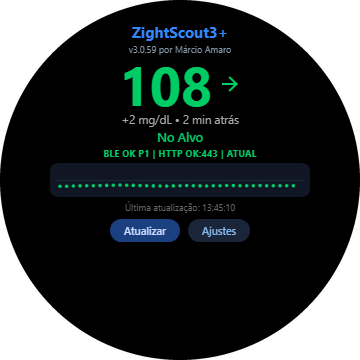 | 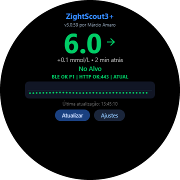 |
| Glicemia em mg/dL com seta de tendência | Glicemia em mmol/L com delta |

### Configurações

| Intervalos e Metas | Alertas e Vibração | Servidor e Token |
|:---:|:---:|:---:|
| 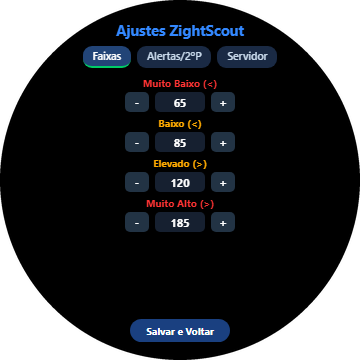 | 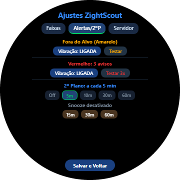 | 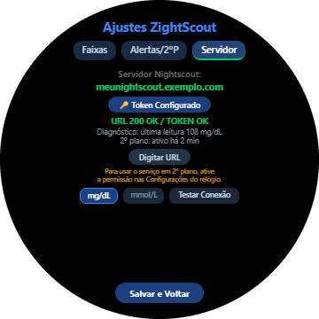 |
| Define seus limites de glicemia | Configura alertas e vibração | Conecta ao seu Nightscout |

---

## ✨ O que torna o ZightScout especial?

### 🩸 Leitura de glicose em tempo real
Seu valor de glicemia atualizado direto no relógio, em **mg/dL** ou **mmol/L**, com seta de tendência (⇈ ↑ ↗ → ↘ ↓ ⇊ ⇕ -) e delta desde a última leitura. Nunca mais você deixará de saber para onde sua glicemia está indo.

### 🔔 Alertas inteligentes com vibração
Receba alertas no pulso quando a glicemia sair dos seus limites personalizados:
- **⚠️ Alerta de aviso** — glicemia abaixo ou acima dos limites configurados
- **🚨 Alerta crítico** — hipoglicemia severa ou hiperglicemia grave, com vibração intensa e repetição automática
- **😴 Soneca de alerta** — pause os alertas por 15, 30 ou 60 minutos quando necessário

### 🌙 Monitoramento em segundo plano
O ZightScout continua funcionando mesmo com a tela apagada. Configure intervalos de coleta de **5, 10, 30 ou 60 minutos** e durma tranquilo — o relógio vai te acordar se precisar.

### 📊 Histórico visual de glicemia
Um gráfico das últimas **12 horas** de leituras diretamente na tela, com escala fixa de 40–250 mg/dL para fácil comparação visual.

### 🔒 Segurança desde o início
O token de autenticação do Nightscout **nunca é armazenado no relógio**. Ele fica protegido no seu telefone, dentro do aplicativo Zepp. A URL do servidor é validada em tempo real com HTTPS obrigatório.

### 🌍 34 idiomas nativos
O ZightScout fala a sua língua! Suporte nativo a **34 idiomas** incluindo Árabe, Hebraico (com layout RTL), Tailandês, Hindi, e muito mais.

### 📱 8 famílias de smartwatches Amazfit
Compatível com 8 famílias completas de smartwatches Amazfit com Zepp OS 3.0+ e todas as suas variantes.

---

## 🚀 Instalação rápida (via QR Code)

A forma mais rápida de instalar o ZightScout no seu relógio:

```bash
# 1. Instale o Zeus CLI (ferramenta oficial Zepp OS)
npm install -g @zeppos/zeus-cli

# 2. Faça login com sua conta Zepp
zeus login

# 3. Clone o repositório
git clone https://github.com/marcioamaro/ZightScout.git
cd ZightScout

# 4. Instale as dependências
npm install

# 5. Gere o QR Code de instalação
zeus preview
```

No aplicativo **Zepp** no celular:
1. Abra o app Zepp → **Perfil → Configurações → Sobre**
2. Toque no ícone Zepp **7 vezes** para ativar o Modo Desenvolvedor
3. Vá em **Perfil → Seu dispositivo → Modo Desenvolvedor**
4. Toque em **Escanear** e aponte a câmera para o QR Code no terminal
5. ✅ Pronto! O ZightScout será instalado automaticamente no seu relógio

---

## 🔧 Compilar e instalar manualmente (passo a passo)

### Pré-requisitos

| Ferramenta | Versão mínima | Para que serve |
|---|---|---|
| [Node.js](https://nodejs.org/) | 18+ | Executar scripts e ferramentas |
| [Zeus CLI](https://docs.zepp.com/docs/watchface/guides/zeus-cli/) | Mais recente | Compilar e instalar no relógio |
| Conta Zepp | — | Login para usar o Zeus CLI |
| Aplicativo Zepp | Mais recente | Instalar no relógio via QR ou bridge |

### Passo 1 — Clone o repositório

```bash
git clone https://github.com/marcioamaro/ZightScout.git
cd ZightScout
```

### Passo 2 — Instale as dependências

```bash
npm install
```

### Passo 3 — Faça login no Zeus CLI

```bash
zeus login
```
> Use a mesma conta do aplicativo Zepp no seu celular.

### Passo 4 — Compile o projeto

```bash
# Build de desenvolvimento
zeus build

# Build de produção (otimizado)
zeus build --production
```

O arquivo compilado (`.zab`) será gerado na pasta `dist/`.

### Passo 5 — Instale no relógio

**Opção A: Via QR Code (mais fácil)**
```bash
zeus preview
```
Escaneie o QR Code com o aplicativo Zepp.

**Opção B: Via bridge (recomendado para desenvolvedores)**
```bash
# Terminal — inicie o bridge
zeus bridge

# No prompt do bridge, envie:
connect
install -t "Amazfit Active 2 (Round)"
```

> Substitua `"Amazfit Active 2 (Round)"` pelo nome do seu dispositivo se for diferente.

---

## ⚙️ Configuração inicial no relógio

Após instalar, o ZightScout vai guiar você pela configuração:

1. **Abra o app** no relógio — aparecerá um aviso de configuração inicial
2. Vá para a aba **Servidor** e insira:
   - **URL do Nightscout**: `https://seu-site.nightscout.io` (obrigatório usar HTTPS)
   - **Token de acesso**: seu token Nightscout com permissão de leitura
3. Toque em **Testar Conexão** — você verá `URL 200 OK | TOKEN OK` se estiver tudo certo
4. Configure seus **limites de glicemia** na aba **Intervalos**
5. Ajuste os **alertas e vibração** na aba **Alertas**
6. Defina o **intervalo de monitoramento** em segundo plano (5, 10, 30 ou 60 min)
7. ✅ Tudo configurado! O ZightScout começa a monitorar imediatamente

---

## 📋 Funcionalidades completas

### Tela principal
- ✅ Glicemia atual em tamanho grande (mg/dL ou mmol/L)
- ✅ Seta de tendência com 9 direções (⇈ ↑ ↗ → ↘ ↓ ⇊ ⇕ -)
- ✅ Delta desde a última leitura (ex: +3, -8)
- ✅ Tempo desde a última atualização (ex: "2 min atrás")
- ✅ Indicador de status da conexão Bluetooth e HTTP
- ✅ Botão de atualização manual
- ✅ Versão do app exibida discretamente

### Monitoramento em segundo plano
- ✅ Coleta automática a cada 5, 10, 30 ou 60 minutos
- ✅ Funciona com a tela apagada e relógio bloqueado
- ✅ Autorização nativa da permissão de segundo plano pelo Zepp OS
- ✅ Reinício automático do serviço após reboot do relógio
- ✅ Log de diagnóstico para rastreamento de problemas

### Sistema de alertas
- ✅ Alerta de aviso (vibração leve) para limites configuráveis
- ✅ Alerta crítico (vibração intensa, repetição até 3x) para hipoglicemia grave
- ✅ Sons de notificação nativos do sistema
- ✅ Deduplicação — não repete o mesmo alerta duas vezes para a mesma leitura
- ✅ Soneca de 15, 30 ou 60 minutos
- ✅ Cancelamento de soneca com um toque na tela principal
- ✅ Fila persistente de alertas — nunca perde alertas críticos

### Configurações
- ✅ Limites configuráveis: veryLow, low, high, veryHigh
- ✅ Suporte a mg/dL e mmol/L com conversão automática
- ✅ Validação em tempo real da URL e do token Nightscout
- ✅ Indicador visual do nível de permissão do token (somente leitura ✅ ou admin ❗)
- ✅ Toasts animados de feedback nas ações (sincronizando, conectando, sucesso, erro)

---

<a name="smartwatches-suportados-pt"></a>
## 📱 Smartwatches suportados

O ZightScout é compatível com **8 famílias de smartwatches Amazfit** e suas respectivas variantes:

- **Amazfit Active** (e variantes)
- **Amazfit Balance** (e variantes)
- **Amazfit Cheetah** (e variantes)
- **Amazfit Falcon** (e variantes)
- **Amazfit GTR** (e variantes)
- **Amazfit GTS** (e variantes)
- **Amazfit T-Rex** (e variantes)
- **Amazfit Bip** (e variantes)

> Suporta as versões com Zepp OS 3.0+ e tela de alta resolução. Modelos com resolução reduzida (< 390×400 px) não são suportados para preservar a clareza e legibilidade dos dados.

---

<a name="idiomas-suportados-pt"></a>
## 🌍 Idiomas suportados

O ZightScout é totalmente traduzido em **34 idiomas**:

🇧🇷 Português (BR) · 🇵🇹 Português (PT) · 🇺🇸 English · 🇪🇸 Español · 🇫🇷 Français · 🇩🇪 Deutsch · 🇮🇹 Italiano · 🇯🇵 日本語 · 🇨🇳 中文(简) · 🇹🇼 中文(繁) · 🇰🇷 한국어 · 🇷🇺 Русский · 🇸🇦 العربية · 🇮🇳 हिन्दी · 🇹🇭 ภาษาไทย · 🇻🇳 Tiếng Việt · 🇵🇱 Polski · 🇳🇱 Nederlands · 🇸🇪 Svenska · 🇩🇰 Dansk · 🇫🇮 Suomi · 🇳🇴 Norsk · 🇨🇿 Čeština · 🇸🇰 Slovenčina · 🇭🇺 Magyar · 🇷🇴 Română · 🇭🇷 Srpski · 🇬🇷 Ελληνικά · 🇹🇷 Türkçe · 🇺🇦 Українська · 🇮🇩 Bahasa Indonesia · 🇲🇾 Bahasa Melayu · 🇮🇱 עברית · 🇮🇱 عربي (RTL)

---

## 🏗️ Arquitetura do sistema

```
Servidor Nightscout (HTTPS)
         ▲
         │  fetch()
App-Side Service (no Zepp App do celular)
         ▲
         │  BLE (Bluetooth Low Energy)
App Service (segundo plano no relógio)
         │
         ▼
Tela principal do relógio (Amazfit Active 2, etc.)
```

**Três partes integradas:**
- **Relógio**: exibe a glicemia, dispara alertas, agenda coletas por alarme
- **Celular (App-Side)**: acessa o Nightscout via HTTPS, guarda o token com segurança
- **Nightscout**: seu servidor pessoal com os dados do sensor CGM

---

## 🔐 Privacidade e segurança

- 🔒 O token Nightscout é armazenado **apenas no celular**, nunca no relógio
- 🔒 URLs sem HTTPS são rejeitadas automaticamente
- 🔒 Token nunca aparece em logs ou diagnósticos
- 🔒 Recomendamos usar um token com permissão **somente leitura** (`readable`)
- ⚠️ Este aplicativo é um **monitor de dados CGM**. Não substitui orientação médica.

---

## 📄 Licença

Este projeto é distribuído sob a licença **GPL-3.0**.  
Isso significa que você pode usar, modificar e distribuir livremente — mas qualquer versão derivada também deve ser open-source sob a mesma licença.

Veja o arquivo [LICENSE](LICENSE) para mais detalhes.

---

<div align="center">

Feito com ❤️ por diabéticos, para diabéticos.  
**ZightScout** — porque cada leitura importa.

[⭐ Dê uma estrela no GitHub](https://github.com/marcioamaro/ZightScout) · [🐛 Reportar um bug](https://github.com/marcioamaro/ZightScout/issues) · [💡 Sugerir uma ideia](https://github.com/marcioamaro/ZightScout/issues)

</div>

---

<a name="español"></a>

<div align="center">


# 💉 ZightScout

### Monitor de Glucemia CGM para smartwatches Amazfit & Zepp OS

**Tus datos de glucosa siempre en tu muñeca: rápidos, inteligentes y accesibles.**

[](https://github.com/marcioamaro/ZightScout)
[](https://docs.zepp.com/)
[](LICENSE)
[](#smartwatches-compatibles-es)
[](#idiomas-compatibles-es)
[](https://buymeacoffee.com/marcioamaro)
[](mailto:zightscout@gmail.com)

---

[🇺🇸 English](#english) | [🇧🇷 Português](#português) | 🇪🇸 **Español** | [🇫🇷 Français](#français) | [🇩🇪 Deutsch](#deutsch) | [🇨🇳 中文](#中文) | [🇯🇵 日本語](#日本語)

---

</div>

## ❤️ ¡Bienvenido a ZightScout!

Vivir con diabetes y tener que vigilar la glucemia todo el día es un desafío continuo. **ZightScout** nació para hacer la vida más fácil: conecta tu reloj Amazfit directamente con tu servidor **Nightscout**, mostrando tu glucemia en tiempo real, avisándote con vibraciones cuando los niveles se salen de tus rangos y monitoreando en segundo plano, incluso con la pantalla apagada.

No hace falta sacar el móvil del bolsillo. Solo echa un vistazo a tu muñeca. 💚

---

## 📸 Capturas de pantalla en tu reloj

### Pantalla Principal

| mg/dL | mmol/L |
|:---:|:---:|
|  |  |
| Glucemia en mg/dL con flecha de tendencia | Glucemia en mmol/L con delta |

### Ajustes

| Rangos y Objetivos | Alertas y Vibración | Servidor y Token |
|:---:|:---:|:---:|
| 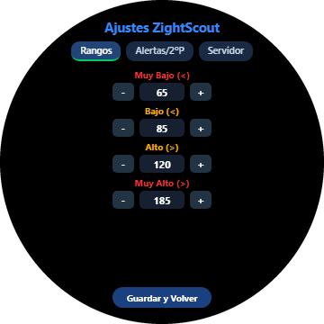 | 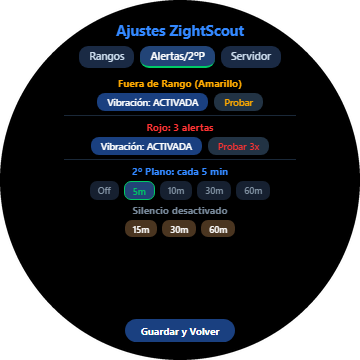 | 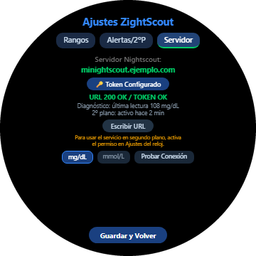 |
| Configura tus límites de glucemia | Configura alertas y vibraciones | Conecta con tu Nightscout |

---

## ✨ ¿Qué hace especial a ZightScout?

### 🩸 Lectura de glucosa en tiempo real
Tu valor de glucemia al instante en tu reloj, en **mg/dL** o **mmol/L**, con flechas de tendencia de 9 direcciones (⇈ ↑ ↗ → ↘ ↓ ⇊ ⇕ -) y delta respecto a la última medición.

### 🔔 Alertas inteligentes con vibración
Siente vibraciones en tu muñeca cuando la glucemia rebase tus límites personalizados:
- **⚠️ Alerta de advertencia** — glucemia fuera del rango normal
- **🚨 Alerta crítica** — hipoglucemia severa o hiperglucemia aguda, con vibración intensa y reintentos automáticos
- **😴 Posponer alerta** — silencia temporalmente los avisos durante 15, 30 o 60 minutos

### 🌙 Monitoreo en segundo plano
ZightScout sigue trabajando mientras el reloj reposa con la pantalla apagada. Configura intervalos de **5, 10, 30 o 60 minutos** y descansa tranquilo.

### 📊 Gráfica visual de 12 horas
Visualiza el historial de las últimas **12 horas** directamente en tu muñeca, con escala fija de 40–250 mg/dL para una interpretación inmediata.

### 🔒 Seguridad desde el diseño
El token de autenticación **nunca se almacena en el reloj**, permanece a salvo en tu teléfono dentro de la app Zepp. Conexión segura mediante HTTPS obligatorio.

### 🌍 34 idiomas nativos
¡ZightScout habla tu idioma! Traducido a **34 idiomas**, con soporte completo para hebreo y árabe (diseño RTL).

### 📱 8 familias de smartwatches Amazfit
Compatible con 8 familias de relojes Amazfit con Zepp OS 3.0+ y todas sus variantes.

---

## 🚀 Instalación rápida (mediante código QR)

```bash
# 1. Instala Zeus CLI (herramienta oficial de Zepp OS)
npm install -g @zeppos/zeus-cli

# 2. Inicia sesión con tu cuenta Zepp
zeus login

# 3. Clona el repositorio
git clone https://github.com/marcioamaro/ZightScout.git
cd ZightScout

# 4. Instala las dependencias
npm install

# 5. Genera el código QR
zeus preview
```

En la app **Zepp** de tu teléfono:
1. Abre Zepp → **Perfil → Ajustes → Acerca de**
2. Pulsa el icono de Zepp **7 veces** para activar el Modo Desarrollador
3. Ve a **Perfil → Tu dispositivo → Modo Desarrollador**
4. Pulsa en **Escanear** y enfoca el código QR de la terminal
5. ✅ ¡Listo! ZightScout se instalará automáticamente en tu reloj

---

## 🔧 Compilación e instalación manual

### Paso 1 — Clona el repositorio
```bash
git clone https://github.com/marcioamaro/ZightScout.git
cd ZightScout
npm install
zeus login
```

### Paso 2 — Compila el proyecto
```bash
# Build de desarrollo
zeus build

# Build de producción (optimizado)
zeus build --production
```

### Paso 3 — Instala en el reloj
```bash
# Mediante bridge
zeus bridge
connect
install -t "Amazfit Active 2 (Round)"
```

---

<a name="smartwatches-compatibles-es"></a>
## 📱 Smartwatches compatibles

Compatible con **8 familias de smartwatches Amazfit** y sus variantes:
- **Amazfit Active** (y variantes)
- **Amazfit Balance** (y variantes)
- **Amazfit Cheetah** (y variantes)
- **Amazfit Falcon** (y variantes)
- **Amazfit GTR** (y variantes)
- **Amazfit GTS** (y variantes)
- **Amazfit T-Rex** (y variantes)
- **Amazfit Bip** (y variantes)

> Compatible con versiones con Zepp OS 3.0+ y pantallas de alta resolución.

---

<a name="idiomas-compatibles-es"></a>
## 🌍 Idiomas compatibles

Traducido completamente a **34 idiomas**:  
🇧🇷 Português (BR) · 🇵🇹 Português (PT) · 🇺🇸 English · 🇪🇸 Español · 🇫🇷 Français · 🇩🇪 Deutsch · 🇮🇹 Italiano · 🇯🇵 日本語 · 🇨🇳 中文(简) · 🇹🇼 中文(繁) · 🇰🇷 한국어 · 🇷🇺 Русский · 🇸🇦 العربية · 🇮🇳 हिन्दी · 🇹🇭 ภาษาไทย · 🇻🇳 Tiếng Việt · 🇵🇱 Polski · 🇳🇱 Nederlands · 🇸🇪 Svenska · 🇩🇰 Dansk · 🇫🇮 Suomi · 🇳🇴 Norsk · 🇨🇿 Čeština · 🇸🇰 Slovenčina · 🇭🇺 Magyar · 🇷🇴 Română · 🇭🇷 Srpski · 🇬🇷 Ελληνικά · 🇹🇷 Türkçe · 🇺🇦 Українська · 🇮🇩 Bahasa Indonesia · 🇲🇾 Bahasa Melayu · 🇮🇱 עברית · 🇮🇱 عربي

---

## 🔐 Privacidad y seguridad

- 🔒 El token Nightscout se almacena **exclusivamente en tu teléfono**.
- 🔒 Exige HTTPS; conexiones no seguras son rechazadas.
- ⚠️ Esta aplicación es un **monitor de datos CGM**. No sustituye el asesoramiento médico profesional.

---

## 📄 Licencia

Distribuido bajo licencia **GPL-3.0**. Consulta el archivo [LICENSE](LICENSE).

---

<div align="center">

Hecho con ❤️ por personas con diabetes, para personas con diabetes.  
**ZightScout** — porque cada lectura cuenta.

</div>

---

<a name="français"></a>

<div align="center">


# 💉 ZightScout

### Moniteur de Glycémie CGM pour montres connectées Amazfit & Zepp OS

**Vos données de glycémie toujours au poignet — rapides, intelligentes et accessibles.**

[](https://github.com/marcioamaro/ZightScout)
[](https://docs.zepp.com/)
[](LICENSE)
[](#montres-compatibles-fr)
[](#langues-compatibles-fr)
[](https://buymeacoffee.com/marcioamaro)
[](mailto:zightscout@gmail.com)

---

[🇺🇸 English](#english) | [🇧🇷 Português](#português) | [🇪🇸 Español](#español) | 🇫🇷 **Français** | [🇩🇪 Deutsch](#deutsch) | [🇨🇳 中文](#中文) | [🇯🇵 日本語](#日本語)

---

</div>

## ❤️ Bienvenue sur ZightScout !

Vivre avec le diabète et devoir surveiller sa glycémie toute la journée est un défi constant. **ZightScout** a été créé pour simplifier votre quotidien : il relie directement votre montre Amazfit à votre serveur **Nightscout**, affichant vos valeurs en temps réel, vous alertant par vibration lorsque vos seuils sont dépassés et surveillant vos données en arrière-plan, même écran éteint.

Plus besoin de sortir votre téléphone. Un simple coup d'œil à votre poignet suffit. 💚

---

## 📸 Aperçu sur votre montre

### Écran Principal

| mg/dL | mmol/L |
|:---:|:---:|
| 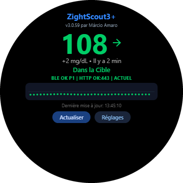 | 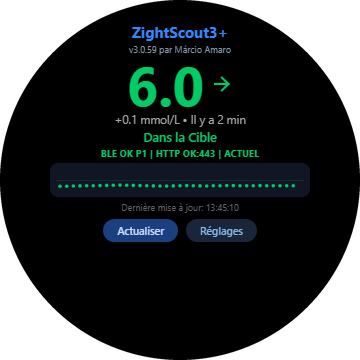 |
| Glycémie en mg/dL avec flèche de tendance | Glycémie en mmol/L avec delta |

### Paramètres

| Plages & Cibles | Alertes & Vibrations | Serveur & Token |
|:---:|:---:|:---:|
| 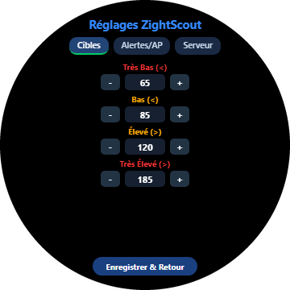 | 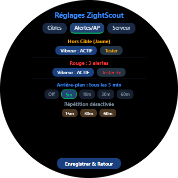 |  |
| Définissez vos seuils de glycémie | Configurez alertes et vibrations | Connectez votre Nightscout |

---

## ✨ Pourquoi ZightScout est-il unique ?

### 🩸 Glycémie en temps réel
Vos mesures instantanées en **mg/dL** ou **mmol/L**, avec flèches de tendance à 9 directions (⇈ ↑ ↗ → ↘ ↓ ⇊ ⇕ -) et delta depuis la dernière lecture.

### 🔔 Alertes vibrantes intelligentes
- **⚠️ Alerte d'avertissement** — dépassement de vos seuils personnalisés
- **🚨 Alerte critique** — hypoglycémie sévère ou hyperglycémie aiguë avec vibration intense et répétitions automatiques
- **😴 Répétition d'alerte (Snooze)** — mise en pause pendant 15, 30 ou 60 minutes

### 🌙 Surveillance continue en arrière-plan
ZightScout fonctionne même écran éteint. Intervalles configurables de **5, 10, 30 ou 60 minutes**.

### 📊 Graphique d'historique de 12 heures
Courbe visuelle des 12 dernières heures directement sur la montre (échelle fixe 40–250 mg/dL).

### 🔒 Sécurité et confidentialité
Le token d'authentification **reste exclusivement sur votre smartphone**. Chiffrement HTTPS obligatoire.

### 📱 8 familles de montres Amazfit
Compatible avec 8 familles de montres Amazfit sous Zepp OS 3.0+ et toutes leurs variantes.

---

## 🚀 Installation rapide (via QR Code)

```bash
npm install -g @zeppos/zeus-cli
zeus login
git clone https://github.com/marcioamaro/ZightScout.git
cd ZightScout
npm install
zeus preview
```

Depuis l'application **Zepp** : activez le Mode Développeur dans Profil → Paramètres → À propos (7 tapes sur l'icône), puis scannez le QR code.

---

<a name="montres-compatibles-fr"></a>
## 📱 Montres connectées compatibles

Compatible avec **8 familles de montres Amazfit** et leurs variantes :
- **Amazfit Active** (et variantes)
- **Amazfit Balance** (et variantes)
- **Amazfit Cheetah** (et variantes)
- **Amazfit Falcon** (et variantes)
- **Amazfit GTR** (et variantes)
- **Amazfit GTS** (et variantes)
- **Amazfit T-Rex** (et variantes)
- **Amazfit Bip** (et variantes)

---

<a name="langues-compatibles-fr"></a>
## 🌍 Langues prises en charge

Disponible en **34 langues natives** : français, anglais, portugais, espagnol, allemand, italien, japonais, chinois, arabe, hébreu, etc.

---

## 📄 Licence

Distribué sous licence **GPL-3.0**. Voir le fichier [LICENSE](LICENSE).

---

<div align="center">

Créé avec ❤️ par des personnes diabétiques, pour des personnes diabétiques.  
**ZightScout** — parce que chaque mesure compte.

</div>

---

<a name="deutsch"></a>

<div align="center">


# 💉 ZightScout

### CGM-Glukosemonitor für Amazfit & Zepp OS Smartwatches

**Ihre Glukosedaten jederzeit am Handgelenk — schnell, intelligent und zugänglich.**

[](https://github.com/marcioamaro/ZightScout)
[](https://docs.zepp.com/)
[](LICENSE)
[](#unterstuetzte-smartwatches-de)
[](#unterstuetzte-sprachen-de)
[](https://buymeacoffee.com/marcioamaro)
[](mailto:zightscout@gmail.com)

---

[🇺🇸 English](#english) | [🇧🇷 Português](#português) | [🇪🇸 Español](#español) | [🇫🇷 Français](#français) | 🇩🇪 **Deutsch** | [🇨🇳 中文](#中文) | [🇯🇵 日本語](#日本語)

---

</div>

## ❤️ Willkommen bei ZightScout!

Das Leben mit Diabetes und die ständige Kontrolle des Blutzuckerspiegels ist eine tägliche Herausforderung. **ZightScout** wurde entwickelt, um dies spürbar zu erleichtern: Es verbindet Ihre Amazfit-Smartwatch direkt mit Ihrem **Nightscout**-Server, zeigt Ihren Blutzucker in Echtzeit an, warnt zuverlässig per Vibration bei Grenzwertüberschreitungen und überwacht kontinuierlich im Hintergrund — selbst bei ausgeschaltetem Display.

Sie müssen Ihr Smartphone nicht mehr aus der Tasche holen. Ein kurzer Blick auf Ihr Handgelenk genügt. 💚

---

## 📸 Screenshots auf Ihrer Smartwatch

### Hauptbildschirm

| mg/dL | mmol/L |
|:---:|:---:|
| 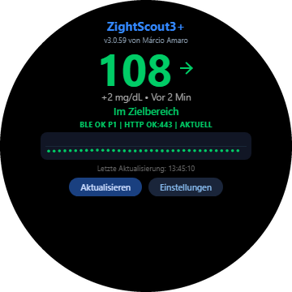 | 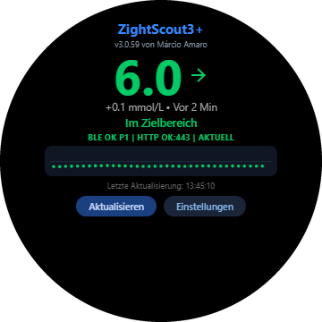 |
| Blutzucker in mg/dL mit Trendpfeil | Blutzucker in mmol/L mit Delta |

### Einstellungen

| Bereiche & Ziele | Alarme & Vibration | Server & Token |
|:---:|:---:|:---:|
| 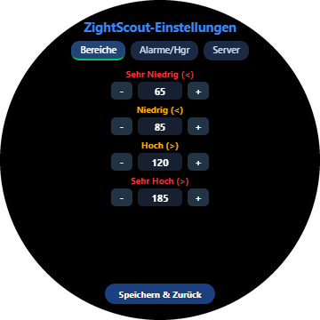 | 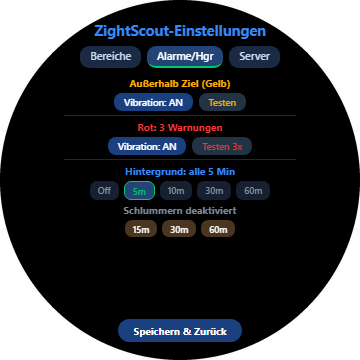 | 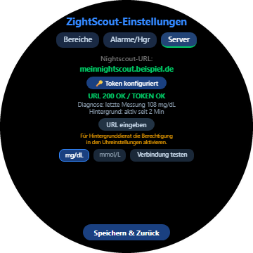 |
| Glukosegrenzen festlegen | Alarme und Vibrationen konfigurieren | Mit Nightscout verbinden |

---

## ✨ Was macht ZightScout besonders?

### 🩸 Echtzeit-Glukoseanzeige
Aktuelle Werte in **mg/dL** oder **mmol/L**, mit präzisen 9-Wege-Trendpfeilen (⇈ ↑ ↗ → ↘ ↓ ⇊ ⇕ -) und Delta zur vorherigen Messung.

### 🔔 Intelligente Vibrationsalarme
- **⚠️ Warnalarm** — bei Verlassen des konfigurierten Zielbereichs
- **🚨 Kritischer Alarm** — bei schwerer Hypoglykämie oder starker Hyperglykämie mit intensiver Vibration und automatischer Wiederholung
- **😴 Schlummerfunktion (Snooze)** — Alarm für 15, 30 oder 60 Minuten stummschalten

### 🌙 Zuverlässige Hintergrundüberwachung
Funktioniert kontinuierlich auch bei gesperrter Uhr und ausgeschaltetem Bildschirm. Abrufintervalle: **5, 10, 30 oder 60 Minuten**.

### 📊 12-Stunden-Verlaufsdiagramm
Grafische Visualisierung der letzten 12 Stunden auf einer festen Skala von 40–250 mg/dL direkt auf dem Zifferblatt.

### 🔒 Sicherheit & Datenschutz
Ihr Nightscout-Token wird **ausschließlich auf dem Smartphone** gespeichert und gelangt niemals auf die Uhr. HTTPS ist zwingend erforderlich.

### 📱 8 Amazfit Smartwatch-Familien
Kompatibel mit 8 Amazfit-Familien mit Zepp OS 3.0+ sowie sämtlichen Varianten.

---

## 🚀 Schnellinstallation (über QR-Code)

```bash
npm install -g @zeppos/zeus-cli
zeus login
git clone https://github.com/marcioamaro/ZightScout.git
cd ZightScout
npm install
zeus preview
```

In der **Zepp-App**: Entwicklermodus aktivieren (Profil → Einstellungen → Über → 7x auf das Zepp-Logo tippen) und QR-Code scannen.

---

<a name="unterstuetzte-smartwatches-de"></a>
## 📱 Unterstützte Smartwatches

Kompatibel mit **8 Amazfit-Smartwatch-Familien** und ihren Varianten:
- **Amazfit Active** (und Varianten)
- **Amazfit Balance** (und Varianten)
- **Amazfit Cheetah** (und Varianten)
- **Amazfit Falcon** (und Varianten)
- **Amazfit GTR** (und Varianten)
- **Amazfit GTS** (und Varianten)
- **Amazfit T-Rex** (und Varianten)
- **Amazfit Bip** (und Varianten)

---

<a name="unterstuetzte-sprachen-de"></a>
## 🌍 Unterstützte Sprachen

Vollständig übersetzt in **34 Sprachen**: Deutsch, Englisch, Portugiesisch, Spanisch, Französisch, Italienisch, Japanisch, Chinesisch, Arabisch, Hebräisch u.v.m.

---

## 📄 Lizenz

Veröffentlicht unter der **GPL-3.0 Lizenz**. Siehe [LICENSE](LICENSE).

---

<div align="center">

Mit ❤️ von Diabetikern für Diabetiker entwickelt.  
**ZightScout** — weil jeder Messwert zählt.

</div>

---

<a name="中文"></a>

<div align="center">


# 💉 ZightScout

### 适用于 Amazfit & Zepp OS 智能手表的 CGM 动态血糖监视器

**您的血糖数据时刻在手腕呈现——快速、智能、随手可及。**

[](https://github.com/marcioamaro/ZightScout)
[](https://docs.zepp.com/)
[](LICENSE)
[](#支持的智能手表-zh)
[](#支持的语言-zh)
[](https://buymeacoffee.com/marcioamaro)
[](mailto:zightscout@gmail.com)

---

[🇺🇸 English](#english) | [🇧🇷 Português](#português) | [🇪🇸 Español](#español) | [🇫🇷 Français](#français) | [🇩🇪 Deutsch](#deutsch) | 🇨🇳 **中文** | [🇯🇵 日本語](#日本語)

---

</div>

## ❤️ 欢迎使用 ZightScout！

与糖尿病共处并全天候关注血糖水平是一项艰巨的挑战。**ZightScout** 的诞生就是为了让这一切变得更轻松：它将您的 Amazfit 智能手表直接连接到您的 **Nightscout** 服务器，实时显示血糖数据，超出自定义范围时通过震动即时提醒，并在后台全天候持续监测——即使屏幕息屏也能稳定运行。

您无需频繁掏出手机，只需轻轻抬起手腕，健康数据一目了然。💚

---

## 📸 手表运行实拍图

### 主屏幕

| mg/dL 单位 | mmol/L 单位 |
|:---:|:---:|
| 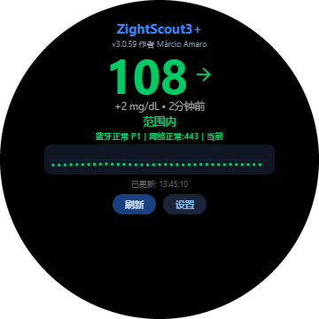 | 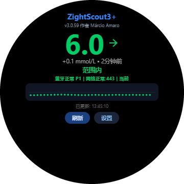 |
| mg/dL 血糖值与 9 向趋势箭头 | mmol/L 血糖值与变化差值 |

### 设置页面

| 阈值范围设置 | 警报与震动配置 | 服务器与 Token 验证 |
|:---:|:---:|:---:|
| 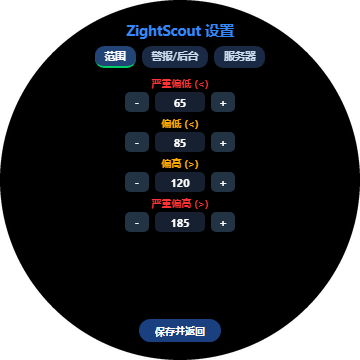 | 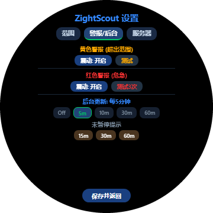 | 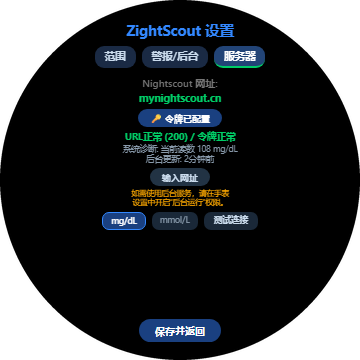 |
| 自定义高低血糖界限 | 设置提醒与强力震动模式 | 实时测试 Nightscout 连接 |

---

## ✨ 为什么选择 ZightScout？

### 🩸 实时血糖监测
手表端直观呈现当前血糖值（支持 **mg/dL** 与 **mmol/L**），附带 9 方向趋势指示箭头（⇈ ↑ ↗ → ↘ ↓ ⇊ ⇕ -）及相比上一读数的变化差值。

### 🔔 智能震动警报
- **⚠️ 预警提醒** — 血糖超出正常目标区间时轻柔提醒
- **🚨 危险报警** — 出现严重低血糖或严重高血糖时强力震动，并具备自动重试提醒机制
- **😴 贪睡模式 (Snooze)** — 支持 15、30 或 60 分钟暂缓提醒

### 🌙 全天候后台持续守护
即使手表处于熄屏或锁定状态，系统也会按照设定的 **5、10、30 或 60 分钟** 周期自动同步最新数据。

### 📊 12 小时历史趋势折线图
主屏幕内置直观的近 12 小时血糖历史曲线，固定 40–250 mg/dL 刻度，轻松判断全天控制趋势。

### 🔒 严谨的隐私与数据安全
Nightscout 访问令牌 **仅保存在手机端 Zepp App 中**，绝不传输或储存在手表硬件存储中。全程强制采用 HTTPS 加密连接。

### 📱 8 大 Amazfit 智能手表家族
全面支持搭载 Zepp OS 3.0+ 的 8 大 Amazfit 系列及其全部区域型号。

---

## 🚀 极速安装（通过二维码）

```bash
# 1. 全局安装官方开发工具 Zeus CLI
npm install -g @zeppos/zeus-cli

# 2. 登录您的 Zepp 账号
zeus login

# 3. 克隆代码仓库并安装依赖
git clone https://github.com/marcioamaro/ZightScout.git
cd ZightScout
npm install

# 4. 生成安装预览二维码
zeus preview
```

在手机 **Zepp App** 中：前往「我的 → 设置 → 关于」，连续点击 Zepp 图标 **7 次** 开启开发者模式，进入「我的 → 您的手表设备 → 开发者模式」，点击扫码安装即可。

---

<a name="支持的智能手表-zh"></a>
## 📱 支持的智能手表

支持以下 **8 大 Amazfit 智能手表系列** 及其所有衍生型号：
- **Amazfit Active** 系列（及所有衍生版本）
- **Amazfit Balance** 系列（及所有衍生版本）
- **Amazfit Cheetah** 系列（及所有衍生版本）
- **Amazfit Falcon** 系列（及所有衍生版本）
- **Amazfit GTR** 系列（及所有衍生版本）
- **Amazfit GTS** 系列（及所有衍生版本）
- **Amazfit T-Rex** 系列（及所有衍生版本）
- **Amazfit Bip** 系列（及所有衍生版本）

---

<a name="支持的语言-zh"></a>
## 🌍 完整支持 34 种语言

原生支持简体中文、繁体中文、英语、葡萄牙语、西班牙语、法语、德语、日语、韩语、俄语、阿拉伯语、希伯来语等 **34 种全球语言**。

---

## 📄 开源许可证

本项目基于 **GPL-3.0** 开源许可证发布。详情请查阅 [LICENSE](LICENSE) 文件。

---

<div align="center">

由糖尿病患者用心打造，专为糖尿病患者服务。  
**ZightScout** —— 守护每一次心跳与读数。

</div>

---

<a name="日本語"></a>

<div align="center">


# 💉 ZightScout

### Amazfit & Zepp OS スマートウォッチ向け CGM 血糖値モニター

**いつでも手首に血糖データを — 高速、高機能、そして親しみやすく。**

[](https://github.com/marcioamaro/ZightScout)
[](https://docs.zepp.com/)
[](LICENSE)
[](#対応スマートウォッチ-ja)
[](#対応言語-ja)
[](https://buymeacoffee.com/marcioamaro)
[](mailto:zightscout@gmail.com)

---

[🇺🇸 English](#english) | [🇧🇷 Português](#português) | [🇪🇸 Español](#español) | [🇫🇷 Français](#français) | [🇩🇪 Deutsch](#deutsch) | [🇨🇳 中文](#中文) | 🇯🇵 **日本語**

---

</div>

## ❤️ ZightScout へようこそ！

糖尿病とともに暮らし、一日中血糖値を気にかけ続けることは決して容易ではありません。**ZightScout** はその負担を和らげるために生まれました。お使いの Amazfit スマートウォッチを **Nightscout** サーバーに直接リンクさせ、リアルタイムで血糖値を表示。設定範囲を外れた際には心地よい振動で通知し、画面が消灯している間もバックグラウンドで静かに見守り続けます。

スマートフォンをポケットから取り出す必要はありません。手首を見るだけで、いつでも安心を確認できます。💚

---

## 📸 ウォッチ画面のプレビュー

### メイン画面

| mg/dL 表示 | mmol/L 表示 |
|:---:|:---:|
| 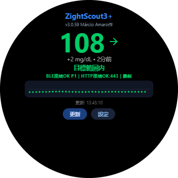 | 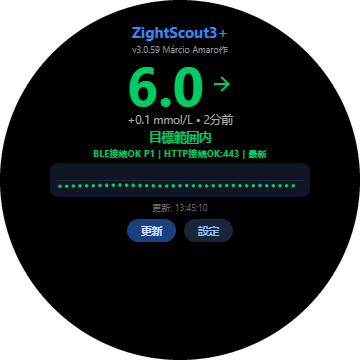 |
| mg/dL 血糖値と 9 方向トレンド矢印 | mmol/L 血糖値と前回差分 (Delta) |

### 設定画面

| 血糖目標範囲 | アラートと振動設定 | サーバーと認証トークン |
|:---:|:---:|:---:|
| 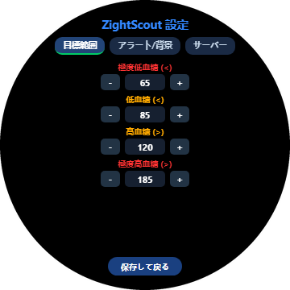 | 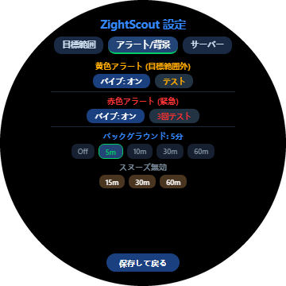 | 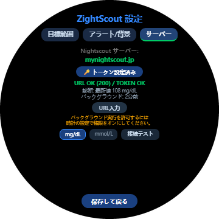 |
| 高低血糖の閾値を設定 | アラート条件と振動パターン | Nightscout 接続の即時検証 |

---

## ✨ ZightScout が選ばれる理由

### 🩸 リアルタイムの血糖値表示
手首を傾けるだけで、現在の血糖値（**mg/dL** または **mmol/L**）、9 方向のトレンド矢印（⇈ ↑ ↗ → ↘ ↓ ⇊ ⇕ -）、前回の読み取りからの増減幅（Delta）がすぐに確認できます。

### 🔔 スマート振動アラート
- **⚠️ 警告アラート** — 設定した目標範囲を超過した際に通知
- **🚨 緊急アラート** — 重度の低血糖や高血糖を強力な振動と自動再試行で確実に伝達
- **😴 スヌーズ機能** — 必要に応じて 15分、30分、60分間アラートを一時停止

### 🌙 バックグラウンド常時モニタリング
画面消灯時やウォッチロック中も、**5分、10分、30分、60分** 間隔で自動的に最新データを取得します。

### 📊 12時間履歴グラフ
メイン画面に直近12時間の血糖トレンドを表示（40〜250 mg/dL 固定スケール）。

### 🔒 万全のプライバシーとセキュリティ
Nightscout のアクセス認証トークンは**スマートフォンの Zepp アプリ内にのみ安全に保持**され、ウォッチ本体には保存されません。HTTPS 通信が必須です。

### 📱 8大 Amazfit シリーズに対応
Zepp OS 3.0+ を搭載した 8 大 Amazfit スマートウォッチシリーズとすべての派生モデルに対応。

---

## 🚀 クイックインストール（QRコード）

```bash
npm install -g @zeppos/zeus-cli
zeus login
git clone https://github.com/marcioamaro/ZightScout.git
cd ZightScout
npm install
zeus preview
```

スマートフォン側の **Zepp アプリ** にて「プロフィール → 設定 → アプリについて」を開き、Zepp ロゴを **7回タップ** して開発者モードを有効化した後、QRコードをスキャンしてインストールします。

---

<a name="対応スマートウォッチ-ja"></a>
## 📱 対応スマートウォッチ

以下の **8大 Amazfit シリーズ** および各派生モデルに対応しています：
- **Amazfit Active** シリーズ（および派生モデル）
- **Amazfit Balance** シリーズ（および派生モデル）
- **Amazfit Cheetah** シリーズ（および派生モデル）
- **Amazfit Falcon** シリーズ（および派生モデル）
- **Amazfit GTR** シリーズ（および派生モデル）
- **Amazfit GTS** シリーズ（および派生モデル）
- **Amazfit T-Rex** シリーズ（および派生モデル）
- **Amazfit Bip** シリーズ（および派生モデル）

---

<a name="対応言語-ja"></a>
## 🌍 34 の言語に対応

日本語、英語、ポルトガル語、スペイン語、フランス語、ドイツ語、中国語、韓国語、アラビア語、ヘブライ語を含む **34 の言語** を完全ネイティブサポートしています。

---

## 📄 ライセンス

本プロジェクトは **GPL-3.0** ライセンスのもとで公開されています。詳細は [LICENSE](LICENSE) をご覧ください。

---

<div align="center">

糖尿病を持つ仲間によって、糖尿病を持つすべての人のために。  
**ZightScout** — 一つひとつの測定値が、あなたの毎日に寄り添います。

</div>

